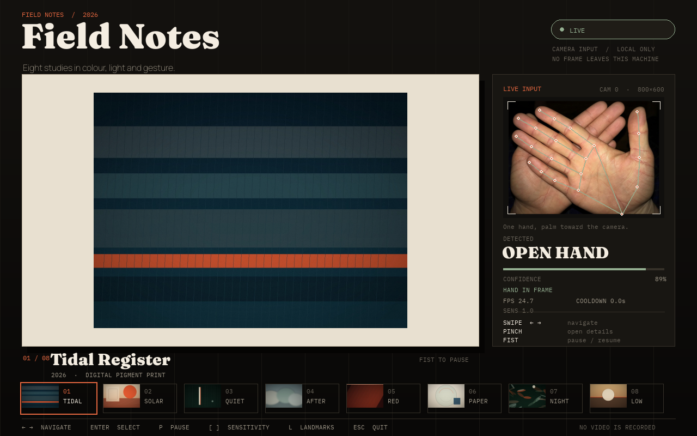

# hand-gesture-gallery-controller

> Control a small image gallery from a webcam with three hand gestures — swipe to navigate, pinch to open details, fist to pause. No mouse, no keyboard required.



*UI preview using a still, licensed test frame and real MediaPipe landmarks. The FPS readout is blank because the screenshot renders a single still frame; the normal app uses the live webcam and shows measured FPS. Nothing is recorded. See [docs/ATTRIBUTION.md](docs/ATTRIBUTION.md).*

**Status:** ✅ MVP implemented and tested — the guided live benchmark is included, but a full human session has not been run in this repository. No accuracy numbers are invented below.

## Why this project exists

Touchless interfaces are a useful testbed for real-time computer vision. The model output is noisy, human timing matters, and a single false positive is immediately visible. This demo keeps the scope deliberately small — one hand, three gestures, eight artworks — so the hard parts remain visible:

- turning 21 landmarks into scale-invariant features;
- confirming gestures over time instead of trusting one frame;
- requiring a neutral pose and a cooldown between actions;
- making failure graceful with a keyboard fallback;
- measuring latency and false activations honestly.

It builds on an earlier personal experiment with hand tracking, rewritten as a reproducible public demo.

## What it demonstrates

- Real-time hand tracking with **MediaPipe Hand Landmarker** and **OpenCV**.
- A Pygame gallery kiosk with transitions, a live camera monitor, landmark overlay, confidence, FPS and cooldown feedback.
- A pure feature layer: palm center, palm width, pinch ratio and finger extension.
- Temporal rules: 6-of-8 frame confirmation for swipes and pinches, a five-frame majority smoother for the fist path, a neutral zone and a 600 ms cooldown.
- A guided benchmark that records **counts only** — no frames, video or images.
- Keyboard fallback that remains available when the camera or model is missing.

**Out of scope:** OS-level cursor control, sign-language recognition, training a custom detector, video recording or streaming, multi-hand interaction.

## Gestures

All distances are normalized by **palm width**: the distance between the index and pinky MCP (knuckle) landmarks. That makes the thresholds roughly independent of the distance from the camera.

| Gesture | Confirmation rule | Action |
|---|---|---|
| Open-hand swipe right | Open hand in at least 6 of the last 8 frames; palm center moves **more than 0.5 palm widths** over **400 ms** to the right | `NEXT` |
| Open-hand swipe left | Same rule, moving left | `PREVIOUS` |
| Pinch | Thumb–index distance **< 0.25 palm widths** for 6 of 8 frames | `SELECT` (open details) |
| Fist | At least **3 of 4** fingertips are closer to the wrist than their middle (PIP) joint | `PAUSE` / resume |

Additional guards:

- **Smoother:** the last five predictions; a gesture needs a majority of 3 and mean confidence ≥ 0.5.
- **Pinch hysteresis:** release requires the ratio to rise above **0.40** for three frames, so a held pinch does not repeat.
- **Fist release:** the fist must open for five frames before another fist can fire.
- **Cooldown:** **600 ms** after every confirmed gesture.
- **Neutral zone:** after an event, six still, open-hand frames are required before another gesture can be armed. Returning the hand to the middle cannot trigger an opposite swipe by itself.
- **No hand in frame:** no action, ever.

Sensitivity `1.0` uses the values above. Higher sensitivity makes swipes shorter and pinches easier; lower sensitivity does the opposite. The exact mapping is in `src/gesture_gallery/gesture_rules.py`.

## Architecture

```text
webcam ──► camera.py ──► hand_tracker.py ──► features.py
                                                   │
                                                   ▼
                                          gesture_rules.py
                                                   │
                                      smoother.py ─┤
                                      cooldown.py ─┤
                                                   ▼
                                            controller.py
                                      NEXT / PREVIOUS / SELECT / PAUSE
                                                   │
                                                   ▼
                                               gallery.py        (state)
                                                   │
                                                   ▼
                                                   ui.py           (Pygame rendering)
```

The state machine is deliberately independent of MediaPipe, OpenCV and Pygame. That is what makes the gesture logic testable without a camera.

## Requirements

- Python **3.11** (the project was developed with 3.11.16; MediaPipe wheel compatibility is safer than on very new Python versions).
- A webcam and a graphical display for the live demo.
- Linux, macOS or Windows. The included commands assume a Unix shell.

| Layer | Choice |
|---|---|
| Camera | OpenCV (`opencv-contrib-python`) |
| Hand landmarks | MediaPipe Tasks Vision, Hand Landmarker |
| UI | Pygame 2.6 |
| Numerics | NumPy |
| Tests | pytest |
| Artwork generation | Pillow (development only) |

## Setup

```bash
cd hand-gesture-gallery-controller
python3.11 -m venv .venv
source .venv/bin/activate
python -m pip install --upgrade pip
pip install -r requirements.txt
```

Download the Hand Landmarker model (it is not committed):

```bash
python scripts/download_model.py
```

The script downloads the official float16 task bundle, verifies its SHA-256 digest and writes `models/hand_landmarker.task`.

### Model origin and license

- **Task:** MediaPipe Hand Landmarker, float16, one hand, 21 landmarks.
- **Documentation:** <https://ai.google.dev/edge/mediapipe/solutions/vision/hand_landmarker>
- **Download:** <https://storage.googleapis.com/mediapipe-models/hand_landmarker/hand_landmarker/float16/1/hand_landmarker.task>
- **SHA-256:** `fbc2a30080c3c557093b5ddfc334698132eb341044ccee322ccf8bcf3607cde1`
- **License:** Apache License 2.0, as distributed by Google with the MediaPipe model bundle.

Details and manual-verification instructions are in [`models/README.md`](models/README.md).

## Run

```bash
python app.py
```

If the camera or model is unavailable, the gallery still starts in keyboard mode. You can also force it:

```bash
python app.py --no-camera
```

Useful options:

```bash
python app.py --camera 1                 # second camera
python app.py --sensitivity 1.3          # easier gestures
python app.py --cooldown-ms 900          # slower repeat
python app.py --no-mirror                # disable the mirrored preview
python app.py --hide-landmarks           # cleaner camera monitor
python app.py --fullscreen
```

Environment variables are also accepted: `GESTURE_CAMERA`, `GESTURE_WIDTH`, `GESTURE_HEIGHT`, `GESTURE_FPS`, `GESTURE_MODEL`, `GESTURE_SENSITIVITY`, `GESTURE_MIN_CONFIDENCE`, `GESTURE_COOLDOWN_MS`.

### Keyboard fallback

| Key | Action |
|---|---|
| `←` / `→` | Previous / next work |
| `Enter` or `Space` | Open / close details |
| `P` | Pause / resume |
| `[` / `]` | Lower / raise sensitivity |
| `L` | Toggle landmark overlay |
| `Esc` | Close details, or quit |
| Window close | Releases the camera and tracker |

## The gallery

The eight works are original abstract prints generated by code in `scripts/generate_gallery.py`. They are bundled under `assets/gallery/` and released under **CC BY 4.0**. See [`assets/gallery/LICENSE`](assets/gallery/LICENSE).

The interface is a 1280×800 dark editorial kiosk: one work on a paper mat, a live camera monitor with landmarks and confidence, and a filmstrip for orientation. Pinch opens a detail card with the title, year, medium and a short note.

## Benchmark

The benchmark is a guided live session. It prompts each gesture, records the latency to the detected event, then runs an optional idle period for false activations.

```bash
python benchmark.py --attempts 20 --idle-minutes 5 \
  --lighting normal --distance-cm 60 \
  --notes "desk lamp, plain wall, seated"
```

Press `Space` on the start screen. Press `Esc` to abort. CSV files are written to `reports/` and are gitignored.

Outputs:

- `reports/benchmark_<timestamp>.csv` — one row per attempt, plus one row per idle false activation.
- `reports/benchmark_<timestamp>.summary.json` — per-gesture accuracy, median latency, false activations per minute, median FPS and session metadata.

The CSV schema is defined in [`eval/session_template.csv`](eval/session_template.csv); see [`eval/README.md`](eval/README.md) for the protocol.

### Success target

The project goal is:

- **≥ 17/20 correct actions per gesture**, and
- **≤ 2 false activations during 5 minutes** without intentional gestures.

Those numbers require a person in front of the camera. They are a target, not a result. To make a claim, run the command above and report the generated summary. Do not copy numbers from a different session.

| Metric | Target | Result in this repository |
|---|---|---|
| Correct actions per gesture (20 attempts) | ≥ 17 / 20 | Not measured — live session pending |
| False activations during 5 idle minutes | ≤ 2 | Not measured — live session pending |
| Median event latency | — | Not measured — live session pending |
| FPS in a full session | — | Not measured — live session pending |

The only measured results committed here are the automated tests and manual smoke checks below. The screenshot is a UI preview, not a benchmark result.

### Validation that is included

```
50 automated tests pass locally with the model present
49 passed, 1 skipped in a fresh clone without the model
```

The model smoke test skips itself when `models/hand_landmarker.task` is absent, so the suite is safe to run before the download step. A clean Python 3.11 virtual environment created from `requirements.txt` and `requirements-dev.txt` also installed successfully and ran the same 49-passed / 1-skipped suite. The full suite covers:

- feature extraction and scale invariance;
- the majority smoother, cooldown and controller mapping;
- swipe, pinch and fist rules, including repeat suppression and neutral re-arming;
- gallery navigation and pause/detail transitions;
- camera open/read/release with a fake capture device;
- benchmark summary arithmetic and abort handling;
- a blank-frame Hand Landmarker load test when the model is present;
- a headless Pygame render smoke test.

The camera and model were manually smoke-tested on this machine: an 800×600 webcam stream opened; MediaPipe initialized on CPU; a still open-hand frame produced 21 landmarks and was classified as `open` with four extended fingers and no pinch.

## Design notes

- **Why landmark ratios?** Normalized distances still change when the hand moves closer to the camera. Dividing by palm width makes thresholds comparable at different distances.
- **Why 6 of 8 frames?** One frame of a pinch or a swipe can be wrong. Six of eight rejects isolated noise while keeping the gesture responsive (about 200–300 ms at 30 FPS).
- **Why a neutral zone?** A cooldown alone does not prevent the hand still being at the edge of a swipe from triggering another event. Re-arming only after a still open hand makes the interaction intentional.
- **Why a keyboard fallback?** Camera permissions, lighting and hardware failures should never make the demo unusable.
- **Why counts-only evaluation?** The interaction can be measured without storing video, faces or biometric data. Privacy is part of the design, not an afterthought.

## Privacy

- Webcam frames are processed in memory only. The normal app and the benchmark never write frames, video or images.
- Nothing is sent over the network. The only network operation in the repository is the explicit model download.
- The benchmark CSV contains counts, timestamps, settings and session notes; it contains no image data.
- The screenshot in this README uses a still, licensed test image of a hand, not a recording of the author or a user. See [`docs/ATTRIBUTION.md`](docs/ATTRIBUTION.md).
- If you add your own demo GIF later, record it voluntarily and do not include third-party faces.

## Known limitations

- Accuracy depends on lighting, skin/background contrast, camera quality and hand occlusion.
- Only one hand is tracked. The thresholds are tuned for a hand facing the camera at roughly 40–80 cm.
- The fist rule can be confused by partial occlusion or unusual finger poses.
- The app needs a graphical display; it is not a headless service.
- Performance depends on CPU. The UI shows measured FPS rather than assuming 30.
- MediaPipe's model can have demographic and lighting biases; the benchmark is meant to reveal them in a specific setup, not to certify fairness.
- The benchmark currently measures event counts and latency, not recorded ground truth. A deliberate wrong gesture is still logged as a detection.
- A full 20-attempt-per-gesture session plus five idle minutes has **not** been run in this repository. The harness is ready; the target table is intentionally blank.

## Repository layout

```text
hand-gesture-gallery-controller/
├── app.py                       # Main Pygame loop
├── benchmark.py                 # Guided live benchmark entry point
├── src/gesture_gallery/
│   ├── benchmark.py             # Benchmark flow, CSV and summary
│   ├── camera.py                # Webcam capture and clean release
│   ├── config.py                # CLI, environment and project paths
│   ├── controller.py            # Gesture → event mapping
│   ├── cooldown.py              # Debounce timer
│   ├── features.py              # Landmark-derived measurements
│   ├── gallery.py               # Gallery state and metadata loading
│   ├── gesture_rules.py         # Swipe / pinch / fist state machine
│   ├── hand_tracker.py          # MediaPipe Tasks wrapper
│   ├── smoother.py              # Five-frame majority vote
│   └── ui.py                    # Pygame rendering
├── assets/
│   ├── fonts/                   # Bundle: Fraunces, Manrope, IBM Plex Mono (OFL)
│   └── gallery/                 # Eight original works + metadata
├── docs/
│   ├── screenshot.png           # UI preview
│   ├── test-frame.jpg           # Licensed still used for the preview
│   └── ATTRIBUTION.md
├── eval/
│   ├── README.md
│   └── session_template.csv
├── models/                      # README only; .task file is gitignored
├── scripts/
│   ├── download_model.py
│   ├── generate_gallery.py
│   └── screenshot.py
├── tests/
├── requirements.txt
├── requirements-dev.txt
└── README.md
```

## Development

```bash
pip install -r requirements-dev.txt
pytest -q
```

Regenerate the artwork and screenshot (the model must be downloaded for the screenshot):

```bash
python scripts/generate_gallery.py
python scripts/screenshot.py
```

## Build plan

- [x] 1. Gallery and keyboard navigation, with view separated from input logic.
- [x] 2. Webcam capture with landmark overlay and debug feedback.
- [x] 3. Swipe detection from palm-center displacement over 400 ms, normalized by palm width.
- [x] 4. Pinch (`SELECT`) and fist (`PAUSE`), with live label and confidence.
- [x] 5. Majority voting, 600 ms cooldown and neutral-zone re-arming.
- [x] 6. Stable labels connected to gallery events.
- [ ] 7. Run 20 attempts per action across distances and lighting; log counts without video.
- [x] 8. Screenshot and webcam permissions, keyboard fallback and limitations documented. A GIF was intentionally omitted; the preview uses a still, licensed frame with no face.

## License

- **Code and documentation:** MIT — see [`LICENSE`](LICENSE).
- **Gallery artworks:** CC BY 4.0 — see [`assets/gallery/LICENSE`](assets/gallery/LICENSE).
- **Fonts:** SIL Open Font License 1.1 — original license files are in `assets/fonts/`.
- **Screenshot test frame and screenshot:** CC BY-SA 4.0 — see [`docs/ATTRIBUTION.md`](docs/ATTRIBUTION.md).
- **Hand Landmarker model:** Apache 2.0 — see [`models/README.md`](models/README.md).
